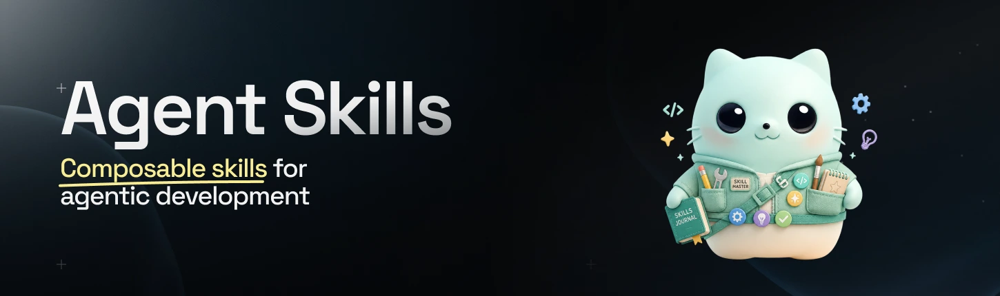

# Agent Skills

Independent, reusable skills for coding agents. Install them with the open
`skills` CLI—no custom installer required.

Read [Avoiding agentic drift in large codebases](https://kevinkern.dev/posts/agentic-drift-in-large-codebase/)
for why these skills exist and how I use them in practice.

## Install

List all skills:

```bash
npx skills add instructa/agent-skills --list
```

Install one skill (or copy a command from the table below):

```bash
npx skills add instructa/agent-skills --skill architecture-ownership
```

Use `-g` for a global installation. Supported agents include Codex, Claude Code,
Cursor, and other Agent Skills clients.

## Available Skills

### Engineering

| Skill | Purpose | Usage | Install |
|---|---|---|---|
| [hard-cut](docs/skills/hard-cut/README.md) | Replace legacy paths with one canonical implementation. | `★★★★★` · 408 sessions | `npx skills add instructa/agent-skills --skill hard-cut` |
| [consolidate-test-suites](docs/skills/consolidate-test-suites/README.md) | Put regression coverage in the owning test layer. | `★★★★★` · 331 sessions | `npx skills add instructa/agent-skills --skill consolidate-test-suites` |
| [lean-testing](docs/skills/lean-testing/README.md) | Avoid unnecessary tests; choose sufficient checks and justify lasting coverage. | New | `npx skills add instructa/agent-skills --skill lean-testing` |
| [root-cause-finder](docs/skills/root-cause-finder/README.md) | Trace failures to their first unintended cause. | `★★★★★` · 159 sessions | `npx skills add instructa/agent-skills --skill root-cause-finder` |
| [architecture-ownership](docs/skills/architecture-ownership/README.md) | Find the right owner for code and behavior. | `★★★★★` · 142 sessions | `npx skills add instructa/agent-skills --skill architecture-ownership` |
| [find-duplicate-ownership](docs/skills/find-duplicate-ownership/README.md) | Find competing sources of truth. | `★★★★☆` · 77 sessions | `npx skills add instructa/agent-skills --skill find-duplicate-ownership` |
| [search-context](docs/skills/search-context/README.md) | Find useful reference repositories before implementing. | `★★☆☆☆` · 6 sessions | `npx skills add instructa/agent-skills --skill search-context` |
| [clarify](docs/skills/clarify/README.md) | Make complex technical material clear and actionable. | `★★☆☆☆` · 2 sessions | `npx skills add instructa/agent-skills --skill clarify` |
| [lean-ci](docs/skills/lean-ci/README.md) | Right-size CI from measured run data instead of adding pipeline machinery. | New | `npx skills add instructa/agent-skills --skill lean-ci` |
| [code-quality](docs/skills/code-quality/README.md) | Check framework fit, data safety and meaningful verification. | New | `npx skills add instructa/agent-skills --skill code-quality` |

### Codex

| Skill | Purpose | Usage | Install |
|---|---|---|---|
| [claude-designer](docs/skills/claude-designer/README.md) | Let Astra call Claude Code directly for UI design, then review and integrate the result. | New | `npx skills add instructa/agent-skills --skill claude-designer` |

### Claude Code

| Skill | Purpose | Usage | Install |
|---|---|---|---|
| [codex-reviewer](docs/skills/codex-reviewer/README.md) | Have Astra review a change while Claude implements, tests and corrects it. | New | `npx skills add instructa/agent-skills --skill codex-reviewer -g -a claude-code` |

### Herdr

| Skill | Purpose | Usage | Install |
|---|---|---|---|
| [delegate-fable](docs/skills/delegate-fable/README.md) | Hand a review or bounded implementation to Fable through Herdr. | `★★★☆☆` · 11 sessions · 130 calls | `npx skills add instructa/agent-skills --skill delegate-fable` |
| [delegate-grok](docs/skills/delegate-grok/README.md) | Hand a review or bounded implementation to Grok through Herdr. | `★★☆☆☆` · 3 sessions · 47 calls | `npx skills add instructa/agent-skills --skill delegate-grok` |
| [delegate-sol](docs/skills/delegate-sol/README.md) | Let Sol review with parallel Terra context or implement a bounded change. | `★☆☆☆☆` · 1 session · 6 calls | `npx skills add instructa/agent-skills --skill delegate-sol` |

### Orchestration

| Skill | Purpose | Usage | Install |
|---|---|---|---|
| [sitrep](docs/skills/sitrep/README.md) | See what your agents are doing, what is blocked and where you are needed. | New | `npx skills add instructa/agent-skills --skill sitrep` |

### Security

| Skill | Purpose | Usage | Install |
|---|---|---|---|
| [secleak-check](docs/skills/secleak-check/README.md) | Scan for secrets and repository risks. | `★★★☆☆` · 24 sessions | `npx skills add instructa/agent-skills --skill secleak-check` |
| [package-security-check](docs/skills/package-security-check/README.md) | Audit JavaScript supply-chain risks. | `★★★☆☆` · 20 sessions | `npx skills add instructa/agent-skills --skill package-security-check` |

### Git

| Skill | Purpose | Usage | Install |
|---|---|---|---|
| [gitwhat](docs/skills/gitwhat/README.md) | Show a concise repository and worktree status. | `★★★★☆` · 34 sessions | `npx skills add instructa/agent-skills --skill gitwhat` |

### Go

| Skill | Purpose | Usage | Install |
|---|---|---|---|
| [go-local-health](docs/skills/go-local-health/README.md) | Run Go tests, coverage, and lint checks. | `★☆☆☆☆` · 1 session | `npx skills add instructa/agent-skills --skill go-local-health` |

### Electron

| Skill | Purpose | Usage | Install |
|---|---|---|---|
| [electron-live-test](docs/skills/electron-live-test/README.md) | Test Electron apps with native-devtools-mcp and CDP. | `★☆☆☆☆` · 1 session | `npx skills add instructa/agent-skills --skill electron-live-test` |

### Shell

| Skill | Purpose | Usage | Install |
|---|---|---|---|
| [shellck](docs/skills/shellck/README.md) | Run ShellCheck on repository scripts. | `★☆☆☆☆` · 1 session | `npx skills add instructa/agent-skills --skill shellck` |

### Specs

| Skill | Purpose | Usage | Install |
|---|---|---|---|
| [app-spec-packager](docs/skills/app-spec-packager/README.md) | Create implementation-ready application specifications. | `★★☆☆☆` · 2 sessions | `npx skills add instructa/agent-skills --skill app-spec-packager` |

### Design

| Skill | Purpose | Usage | Install |
|---|---|---|---|
| [redesign-my-landingpage](docs/skills/redesign-my-landingpage/README.md) | Build and improve React landing pages. | `★☆☆☆☆` · 1 session | `npx skills add instructa/agent-skills --skill redesign-my-landingpage` |

### 3D & Gaming

| Skill | Purpose | Usage | Install |
|---|---|---|---|
| [unity-docs](docs/skills/unity-docs/README.md) | Resolve Unity API questions using version-matched local sources and cached docs. | New | `npx skills add instructa/agent-skills --skill unity-docs` |

### Usage legend

`★★★★★` 100+ sessions · `★★★★☆` 25–99 · `★★★☆☆` 10–24 · `★★☆☆☆` 2–9 · `★☆☆☆☆` 0–1

Herdr skills also show direct calls because one session can delegate several tasks.

## Principles

- Public skills are installed with `npx skills`.
- Human documentation and promotional images live in `docs/skills/`, outside installed skill folders.
- Core engineering skills do not depend on PlanDB, Planr, Instructa, or AgentRig.
- Tool-specific skills only require tools needed for their stated purpose.
- Category folders do not change public skill names.

## Links

- X/Twitter: [@kregenrek](https://x.com/kregenrek)
- Bluesky: [@kevinkern.dev](https://bsky.app/profile/kevinkern.dev)
- [Instructa](https://www.instructa.ai)
